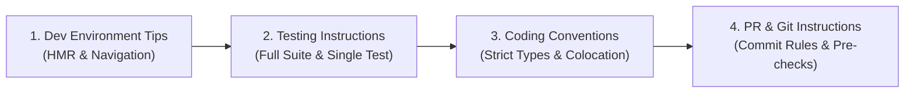

# AGENTS.md Generator & Auditor (Open Standard — Linux Foundation / agents.md)

This skill enables the agent to scaffold, audit, and maintain **`AGENTS.md`** files across single-package repositories and large monorepos. It follows the open specification governed by the **Linux Foundation** ([agents.md](https://agents.md/)), adopted by over 60,000 open-source repositories and supported by all major coding agents (OpenAI Codex, Claude Code, Google Antigravity, Cursor, RooCode, Aider, GitHub Copilot).

---

## Why AGENTS.md?

`README.md` is for humans (quickstarts, marketing, high-level contribution guides).
`AGENTS.md` is for coding agents (hot-reload dev commands, focused test runners, strict style rules, security invariants, and monorepo package navigation).

Separating them keeps human documentation clean while giving AI agents a dedicated, predictable location for operational instructions.

---

## When to Use

Use this skill whenever:
* You want to scaffold a new `AGENTS.md` file at the root of a project.
* You need to audit an existing `AGENTS.md` to ensure it contains actionable test and dev commands.
* You are working on a monorepo and need **nested `AGENTS.md`** files inside subpackages (`packages/<pkg>/AGENTS.md`).
* You need to prevent agent failure modes like running heavy production builds (`npm run build`) that break Hot Module Replacement (HMR).

## When NOT to Use

* For full architectural and security validation of an entire application (use `full-app-validator`).
* For deep static vulnerability scanning (use `appsec-auditor` or `security-diff-scan`).
* For pure TDD code implementation of a single feature (use `driven-development`).

---

## 4 Core Sections of a Compliant AGENTS.md



### 1. Dev Environment Tips
* Explicit dev server command: `npm run dev`, `pnpm dev`, `cargo run`.
* **The Anti-Build Invariant:** Warn agents **NOT** to run production build commands (`npm run build`) during interactive sessions, preventing `.next` or `dist/` caching issues from breaking HMR.
* In monorepos: provide package navigation commands (e.g. `pnpm --filter <project>`).

### 2. Testing Instructions
* Full suite execution command: `pytest`, `npm test`, `cargo test`.
* Focused single-test execution with patterns: `vitest run -t "<test_name>"`, `pytest -k "<name>"`.
* **Zero Alteration Rule:** Agents are forbidden from modifying or disabling existing tests to pass checks.
* Mandatory requirement that all code modifications must include test coverage.

### 3. Coding Conventions
* Language-specific strictness (TypeScript `strict: true`, no `any`, Zod/Pydantic validation).
* File co-location: keep component styles and unit tests next to implementation files.
* Domain error handling: use structured exceptions, never raw strings.

### 4. PR & Git Instructions
* Conventional Commits specification (`feat(scope): ...`, `fix(scope): ...`).
* Pre-commit checks: run formatters (`prettier`, `black`, `ruff`) and linters before committing.

---

## CLI Automation in this Skill

A deterministic validator is provided in this skill to audit any `AGENTS.md` file:

```bash
# Validate root AGENTS.md
python3 skills/agents-md-generator/scripts/validate_agents_md.py AGENTS.md

# Validate with JSON output for CI/CD checks
python3 skills/agents-md-generator/scripts/validate_agents_md.py AGENTS.md --json
```

---

## Verified References
* [AGENTS.md Specification & Reference](references/agents_md_spec.md): Specification details, nested monorepo inheritance, and full templates.
