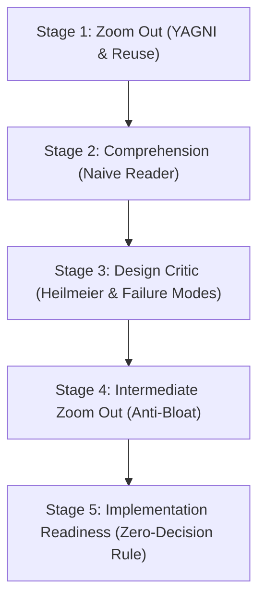

# Goldfish Reviewer (EGM Zero-Context Spec Stress-Testing Protocol)

This skill equips the agent to perform disciplined, zero-context stress testing of software specifications, design drafts, and implementation plans. Inspired by Google's **Elephant-Goldfish Model (EGM)**, it enforces the principle: **"Design with an elephant. Review with a goldfish."**

Reviewers evaluate the document solely against the written artifact and explicitly linked source files, free from conversational baggage, conversational bias, and sycophantic approval.

---

## When to Use

Use this skill whenever:
* A new feature specification or Software Design Document (SDD/RFC) has been drafted.
* An implementation plan needs validation before writing code.
* You need to verify that an implementation plan adheres to the **Zero-Decision Rule** (leaving zero architectural choices to the implementer).
* You want an objective review across the **6 Goldfish Lenses** (YAGNI, Cost & Quotas, DX, Compatibility, Observability, and Tech Debt).

## When NOT to Use

* For code vulnerability and SAST audits (use `appsec-auditor` or `security-diff-scan`).
* For whole-repository health checks (use `full-app-validator`).
* For executing code implementation tasks (use `driven-development`).

---

## The 6 Goldfish Lenses

| Lens | Focus | Core Question |
|---|---|---|
| **1. Contrarian / YAGNI** | Simplicity & scope minimization | *Why does this feature need to exist? Can an existing library or code solve 90% of this without new abstractions?* |
| **2. Cost, Quota & Token Economics** | Resource scaling & bottlenecks | *What is the peak QPS, memory footprint, DB connection load, or LLM token budget? Will it hit quota ceilings?* |
| **3. UX & Developer Ergonomics** | API clarity & developer friction | *Is the API/CLI intuitive? Does it follow standard ecosystem conventions? Are error messages clear and actionable?* |
| **4. Migration & Compatibility** | Rollout safety & schema evolution | *How do existing clients/data migrate? Does this break serialized schemas or APIs? How is rollback handled?* |
| **5. Observability & SRE Debuggability** | Telemetry & production triage | *Are operations traceable? What metrics trigger alerts? How will an on-call engineer diagnose an incident at 3 AM?* |
| **6. Long-Term Tech Debt** | Maintainability & decoupling | *Does this introduce tightly coupled state machines or fragile dependencies that will rot in two years?* |

---

## 5-Stage Evaluation Workflow



### Stage 1: Initial Zoom Out (Simplicity & Codebase Reuse)
- Audit if the document solves the root problem in the simplest possible way.
- Reject premature abstractions, speculative caches, and bespoke libraries when standard dependencies exist.

### Stage 2: Comprehension Test (Self-Containment)
- Test whether a newly onboarded engineer or clean-slate AI subagent can fully understand the specification without asking author clarification.
- Remove marketing adjectives (*"seamless"*, *"blazingly fast"*) and replace them with concrete SLA/throughput definitions.

### Stage 3: Design Critic & Heilmeier Check
- Verify that all questions of the **Heilmeier Catechism** are answered:
  1. *What are you trying to do with zero jargon?*
  2. *How is it done today, and what are the limits?*
  3. *What is new in your approach and why will it succeed?*
  4. *Who cares and what difference will it make?*
  5. *What are the risks and costs?*
  6. *What are the exams/metrics for success?*

### Stage 4: Intermediate Zoom Out
- Check if resolutions and clarifications introduced during earlier stages caused scope creep or architectural bloat.

### Stage 5: Implementation Readiness (The Zero-Decision Rule)
- **THE ZERO-DECISION RULE:** The plan **FAILS** if the implementer has to make architectural or design choices during coding.
- Check that all target file paths, schemas, database columns, HTTP response codes, and error handlers are explicitly declared.

---

## CLI Automation in this Skill

A deterministic validator script is provided to verify document readiness:

```bash
# Verify a specification against the Zero-Decision Rule and Heilmeier criteria
python3 skills/goldfish-reviewer/scripts/run_review.py docs/designs/my_feature.md

# Generate structured JSON report
python3 skills/goldfish-reviewer/scripts/run_review.py docs/designs/my_feature.md --json
```

---

## Verified References
* [Review Rubrics & Quality Bar](references/review_rubrics.md): Formal standards for Zoom-Out, Comprehension, and Implementation Readiness.
